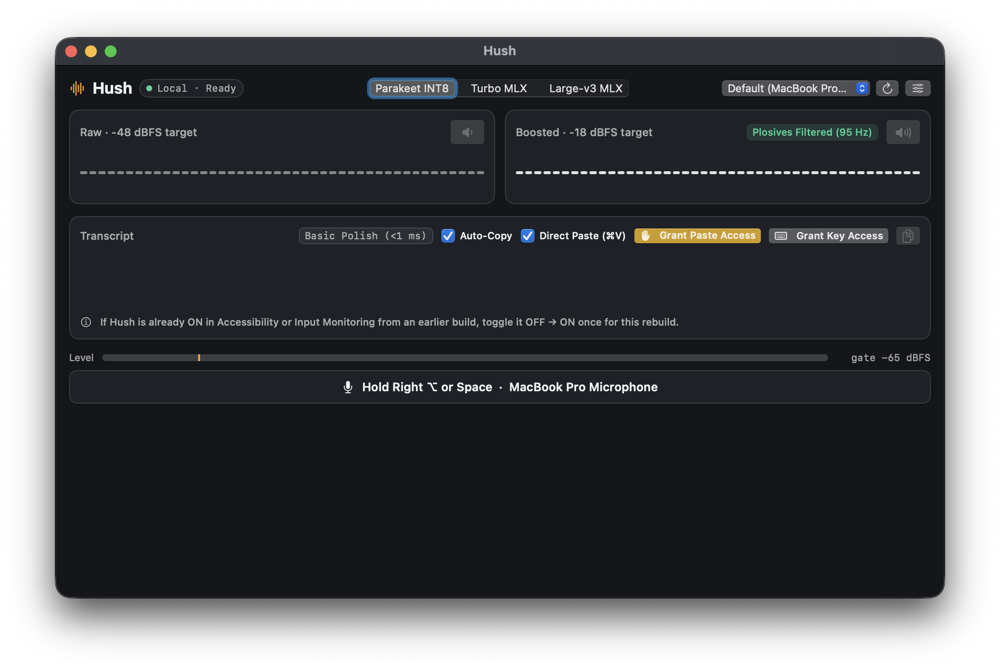
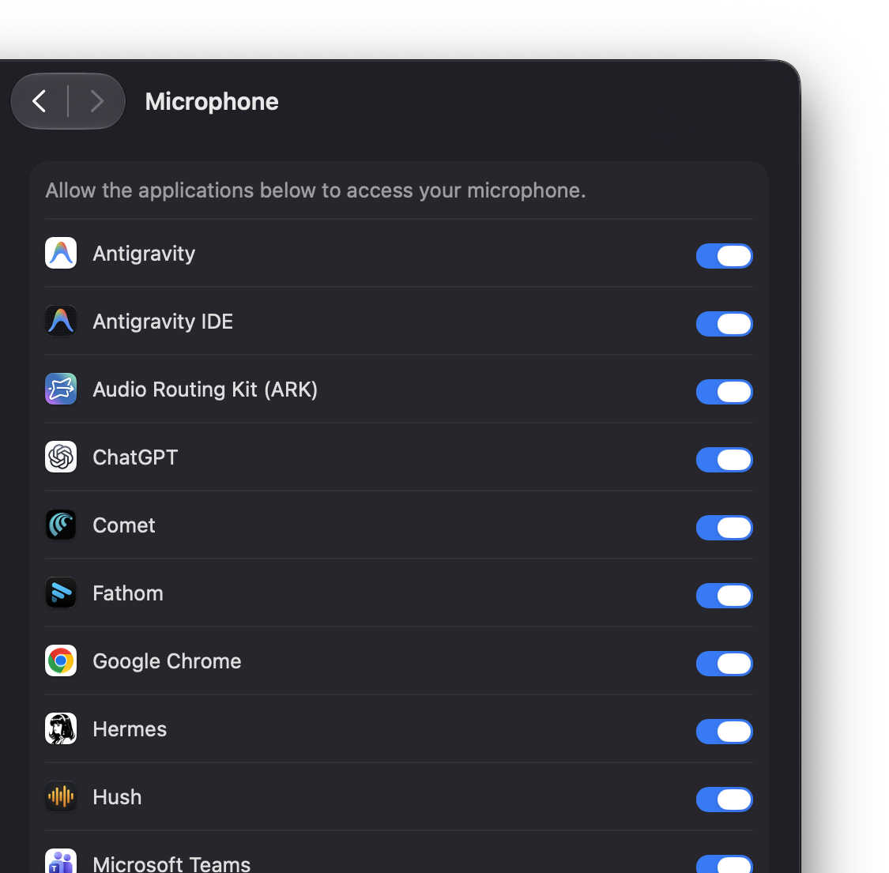
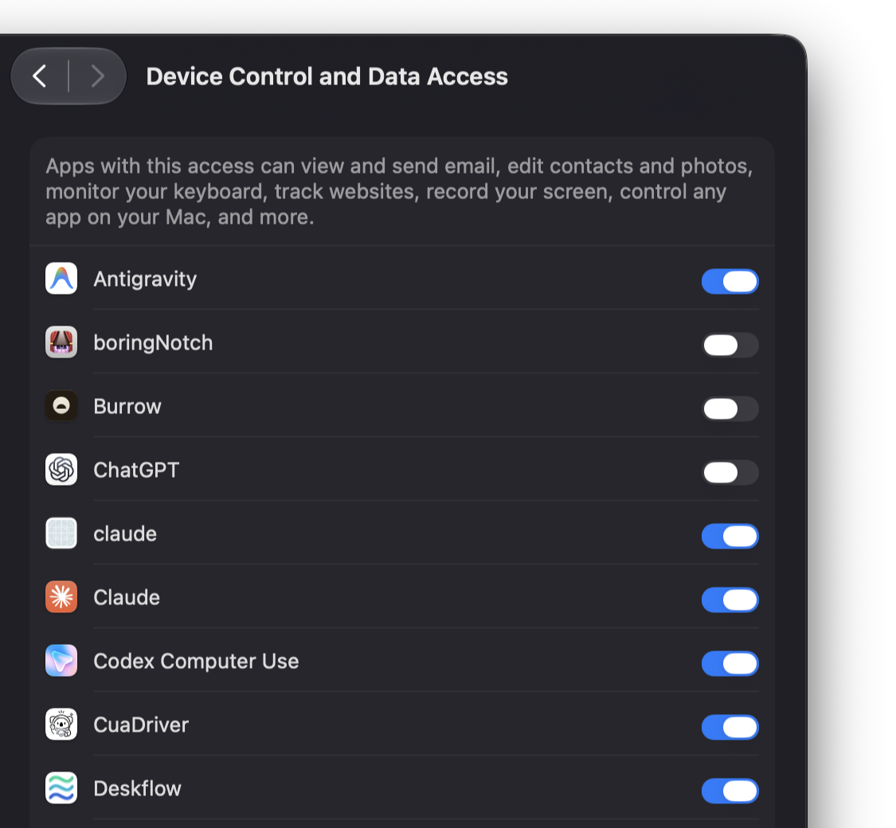
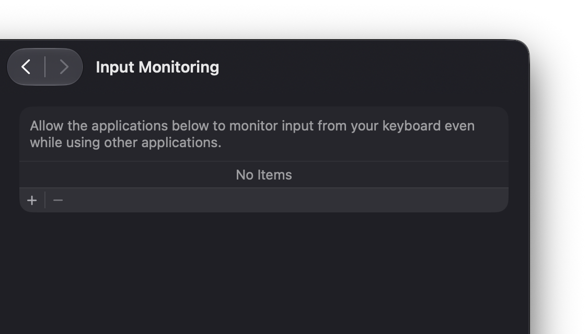

# Hush

Private on-device macOS dictation for Apple Silicon — fast push-to-talk speech recognition with whisper-sensitive audio boost and automatic cursor-aware pasting.

Built by **Mohanaditya**.



---

## 1. Download & Install

### Option A — Download the DMG (Recommended)

1. Download **`Hush.dmg`** from [**Releases**](https://github.com/developer-mohanaditya/hush/releases/latest).
2. Open `Hush.dmg` and drag **Hush.app** into **Applications**.
3. Make sure Python 3.11–3.13 or [`uv`](https://docs.astral.sh/uv/) is available once (`brew install uv python@3.12`) so Hush can set up its local speech environment (`~/Library/Application Support/Hush/venv`) and download the default **Parakeet INT8** model (~640 MB) on first launch.
4. Open **Hush** from **Applications**. *(First launch on an ad-hoc build: right-click **Hush.app** → **Open**, or run `xattr -cr /Applications/Hush.app`.)*

### Option B — Run from Source

```sh
git clone https://github.com/developer-mohanaditya/hush.git
cd hush
./run.sh
```

To package a fresh DMG locally:

```sh
./mac/build_dmg.sh
```

---

## 2. Grant macOS Permissions

Hush stays 100% offline for transcription. macOS needs three permissions so Hush can hear your mic, watch the global push-to-talk key, and paste into the active app:

1. **Microphone** — Click **Allow** on first launch, or toggle **Hush** ON in **System Settings → Privacy & Security → Microphone**.

   

2. **Accessibility (Direct Paste)** — Click **Grant Paste Access** in Hush, then toggle **Hush** ON in **System Settings → Privacy & Security → Accessibility** *(shown as **Device Control and Data Access** on newer macOS versions)*.

   

3. **Input Monitoring (Global Hotkey)** — Click **Grant Key Access** in Hush, click **`+`** in **System Settings → Privacy & Security → Input Monitoring**, and add **`/Applications/Hush.app`**.

   

> If you upgrade or rebuild `Hush.app`, toggle **Hush** OFF → ON once in Accessibility and Input Monitoring.

---

## 3. How to Use

| Action | Control |
|---|---|
| Dictate from any app | Hold **Right Option (`⌥`)** or hold the bottom-right **Floating Mic** orb |
| Dictate inside Hush window | Hold **Space** or click & hold the bottom dictation bar |
| Switch speech model | Pick **Parakeet INT8**, **Turbo MLX**, or **Large-v3 MLX** in the top bar |
| Inspect captured audio | Use the speaker buttons on **Raw** vs. **Boosted** panels |
| Cleanup & thresholds | Click the sliders button in the top-right to configure whisper gate or optional LLM cleanup |

- Text pastes automatically at your cursor with spacing and capitalization adjusted to the surrounding character.
- If no voice is detected or an app blocks paste, Hush shows a compact bottom-right card where you can replay the recording or copy/dismiss.

---

## 4. Benchmarks & Proof

Evaluation dataset (`155` curated & synthetic whisper/noise/hallucination audio probes) and cross-model measurements are included in the repository:

- Benchmark report: [`datasets/REPORT.md`](datasets/REPORT.md)
- Raw benchmark metrics: [`datasets/results.json`](datasets/results.json)
- Dataset manifest & audio probes: [`datasets/data/manifest.json`](datasets/data/manifest.json)
